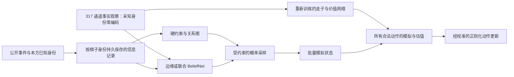

# 联合信念实验复审与下一轮设计

本文是历史复审与分阶段设计，不是实时状态页。2026-10-03 已完成事实联合信念的 GPU 验收、训练和正式对战，见 [实测报告](FACTS_JOINT_COMPARISON_20261003.md)；边缘信念对照按 [2026-10-04 协议](FACTS_BELIEF_ABLATION_20261004.md) 继续。下文“尚未训练/待实现”保留其历史时间范围。

审查日期：2026-10-01。审查依据：实际源码、2347635 的原始报告、已恢复 checkpoint、Ataraxos 原论文及官方代码；另做一次有界 CPU 诊断。本文给出设计，尚未实施新训练。

2026-10-03 工程整理后，旧搜索实现名为 `legacy_joint_search.py`；下文原路径和行号指审查时的历史源码。

用户随后明确修正：新模型移除手工规则信念。2026-10-02 已新增独立的事实输入策略路径，保留严格逻辑信息，禁用手工身份概率及相关估值；见 [实现与训练记录](FACTS_ONLY_TRAINING_20261002.md)。此后已解除新路径的旧概率模块导入依赖，并完成 CPU 持久事实/公共历史接口；新信念网络、GPU 历史采集和搜索仍属后续设计。旧实验结果不变。

2026-10-02 后续进度：新事实基线已完成累计 10,017 局训练及 1,200 局新布局对比，完整 checkpoint、日志和逐局记录已回收并校验。下一阶段固定策略为 `ckpt_000890.pt`，尚未训练新语义 BeliefNet；具体结果和实施顺序见上方训练记录末尾。

## 结论

Ataraxos 的基本路线是：自对弈训练走子网络，冻结后训练联合 BeliefNet，再在测试时用采样状态、模拟和正则化动作更新增强决策。同一个走子网络直接下棋与加搜索后的系统做对比，是合理的实验。上一条解释中“必须另训一个独立走子模型才能比较”没有依据，应撤回。

本次原型的主要缺陷是四人暗棋信息状态适配、采样约束、粒子更新和搜索估值。现有 32 局反映这一具体原型的行为，无法隔离联合建模的贡献，也不足以否定 Ataraxos 路线。94.24% 回退不能作为正常设计接受。

论文依据：[§2.3、§2.5、附录 D.5–D.7](https://arxiv.org/html/2511.07312v1)。官方代码审查版本：`92db29e8ffc323b1b8a2804b5c3f84695d036b05`；关键位置为 `pyengine/belief/masking.py`、`pyengine/belief/sampling.py`、`pyengine/core/search.py`。原版利用当前未知棋子的约束生成状态，GPU 上赋值并模拟；本地原型新增的“从开局逐个 CPU 重放、失败后等待 32 步”不是该路线的必需步骤。

## 审查发现

### P1：已知身份随棋子死亡丢出采样约束

复审时的 `junqi_rl/belief/joint.py:75` 只对活棋合并当前规则概率的支持集；死亡棋子退回初始摆放支持与“曾移动”条件。公开确认的司令、工兵死亡后，采样支持集仍可包含多个身份。联合网络输出与历史重放器接受的配置集合因此不一致。该实现现已移到 `legacy_joint.py`；新的 `joint.py` 使用持久事实/公共历史 schema，保留阵亡身份约束，不消费规则概率。

有界诊断采用保存的真实模型，布局种子 20261003，随机种子 20261011。真实隐藏身份仅用于离线 oracle 重放检查，未用于选择动作或修补模型样本。测试在本地 CPU 执行，不是新胜率评测。

| 诊断位置 | 真实身份重放 | 神经网络生成的 8 个样本 | 具体证据 |
|---|---|---|---|
| 第 0 步 | 通过 | 8/8 通过 | 初始约束可满足 |
| 第 64 步 | 通过 | 0/8 通过 | 两个公开确认的阵亡司令仍有 10、9 个候选身份；两个公开确认的阵亡工兵仍各有 9 个候选身份 |
| 第 128 步 | 通过 | 0/8 通过 | 仍存在上述丢失约束；三个阵亡司令分别有 10、9、10 个候选身份 |

失败多发生在重放开局已公开的工兵走法时，也有战斗结果不匹配。该单局诊断证明接口存在问题，并未证明全部评测失败都由这一原因导致。

证据：`work/beijing-v100-preflight/review-20261001/joint-consistency-probe.json`；可复跑脚本同目录 `probe_joint_consistency.py`。

### P1：单棋子支持与数量一致，不能保证整段公共历史一致

当前 Hall 可行性检查正确处理的是“每颗棋子允许哪些类型＋各类型数量”。它没有编码甲乙两颗未知棋子的战斗关系、阵亡前公开身份，以及部分路径揭示。生成完整的 75 个身份后再全历史拒绝，容易使成功概率随约束增多而下降。只增加训练轮次不能修复遗漏的硬约束接口。

四人 DARK 中队友同样隐藏，阵亡身份未必公开。因此也不能直接删掉全部死亡潜变量，再从引擎读取真实存活类型数量；那会使用观察者无法知道的信息。

### P1：粒子缓存只有排除，没有随行为证据更新概率

`joint_search.py:171–205` 只将新公共事件作用到旧粒子；只要有粒子存活，就不再调用当前 BeliefNet。缓存没有观察到动作后的策略似然权重，也没有固定的后验刷新机制。即使一个走法没有排除任何布局，它也可能改变不同布局的相对概率；当前缓存不会体现这类证据。

两粒子的预算进一步放大了退化。6,004 次回退中有 5,369 次由 32 步失败冷却直接触发，所以 94.24% 是没有执行搜索的决策比例，不是样本的直接错误率。平均 61.78 ms 包含大量直接走子的回退，不能代表完整搜索的单步成本。

### P1：只估计 top-8 动作，其余动作使用根价值

`joint_search.py:223` 选择 top-8；`:252–255` 将其余动作的 Q 值设为根状态 V，再对全部合法动作更新概率。搜索过和没有搜索过的动作使用不同估计器，差异可能来自估值方式而不是动作优劣。

此外，仅一两个样本和四步模拟，却沿用很小的正则系数。按当前公式，Q 误差 0.1 可造成约 `exp(0.1 / 0.022) ≈ 94` 倍的相对概率变化。这个算例说明对噪声敏感，不是对每一步实际误差的估计。不能用论文在更大预算上的系数替代本地校准。

### P2：训练和验证只证明能优化，尚未证明能正确生成

联合训练使用 1,024 条观察行，其中同一时点的四个观察者占四行；它们来自 8 条环境流。实际训练 768 行、512 次更新、约 10 秒。它属于工程试跑，数据多样性有限。

自回归 teacher forcing 的 NLL 是合法的联合分布似然指标，本身没有问题；但它下降并不保证自由生成的完整配置满足硬约束，更不保证搜索增强。当前验证没有把“生成后是否重现观察者信息、分阶段可用率、样本多样性”作为正式运行前的门槛。

## 推荐架构

保留 317 空间通道的尺寸与零全局输入，升级输入语义。新走子网络和两类 BeliefNet 都从观察者可获得的事实学习，不使用手工身份概率。

### 0. 移除规则信念及其依赖

旧 `BeliefTensor` 按初始位置允许类型和 `PIECE_COUNTS` 分配、归一化身份权重，再随事件更新。这样的启发式分布不能当作准确后验，也不再作为新实验的输入、训练目标、正则参照或生成失败时的替代分布。

输入契约如下。走子事实 schema v5 和 CPU 持久历史接口已实现，新信念网络及其 GPU 数据采集仍待实施：

| 内容 | 新模型的处理 |
|---|---|
| 自己可见的身份、位置、所属玩家、公开事件和行动历史 | 保留；信息权限按观察者判断 |
| 未知棋子的规则概率、初始槽位概率表 | 删除生成、维护、缓存和消费路径 |
| `prob_teammate`、`belief_left_side`、`belief_right_side` 的 36 个通道 | 保留通道位置，改为三个玩家的确定身份编码：已知身份 one-hot，未知全零；占位掩码单独表示棋子存在。不得根据规则概率的峰值或单点支持推定“已知” |
| 28 维全局摘要 | 继续禁用 |
| 依赖旧身份分布的 combat v1、tactical v2、relational v1 | 新基线全部禁用；以后若需要，仅以新语义和新版本显式接入 |
| 边缘与联合 BeliefNet | 同一事实输入和事件记录；未知身份概率完全由训练学习 |
| 规则概率混合、KL-to-rules、规则概率回退 | 新路径全部移除 |
| 合法动作、公开确定的身份、确切数量与战斗规则 | 独立的游戏事实/合法性接口；不生成身份概率，不用 `rules > 0` 作为其来源 |

未知通道全零表示“未给出身份”，不能解释成所有类型概率为零。直接公开或按游戏事件确定的身份需要独立的已知身份记录，死亡后仍保存。新输入不能通过读取隐藏类型，再假借“已知”条件泄露真值。

工程上，关闭规则信念必须从创建环境时生效：CPU 不创建/更新旧 `BeliefTensor`，CUDA 不上传先验表、不分配规则概率缓冲、不启动其更新核；rollout history 不存储此类概率。仅在网络入口清零 36 个通道不满足移除要求。公开事实记录只做必要的增量更新。旧模型的规则输入适配仅用于历史对照，独立按旧 schema 创建。

317 的宽度相同不代表语义兼容。新 policy / belief / 数据集 / 观测缓存的元信息必须标记身份编码为 `known_only`，升级输入 schema，加载时拒绝旧概率语义。初次实验从头训练新的事实输入策略 π₀；旧 checkpoint 不能直接作为新基线使用。

第一轮保持 Ataraxos 的分阶段设计：先训练 π₀，冻结后训练边缘/联合 BeliefNet；需要搜索时才运行信念网络。学习到的概率供搜索采样使用，暂不写回 π₀ 的输入。若以后让走子网络直接消费神经信念，需要另行训练相应接口并单独比较。

### 1. 先统一信息记录和约束

建立按 `piece_id` 索引、死亡后仍保留的观察者信息记录：初始位置、已公开身份、已知路径能力、移动/死亡信息、战斗双方身份 ID 及公开结果、本方已知身份。只有原本可见的信息可以进入该接口。

从这份记录增量生成可验证的合法性条件：每颗棋子的类型域、每次交互允许的类型对、各军初始数量及公开揭示条件。这些条件必须由确切的游戏规则与观察者可见事件得到，不从旧概率表提取、不使用猜测阈值。初始槽位可以作为公开位置事实输入；按槽位手工归一化的概率表删除。网络学习概率，采样器仅排除可证明不可能的配置。

第一版可以继续保留最多 75 个隐藏身份，已经确定的身份直接固定并跳过随机解码。未知死亡身份应继续作为潜变量参与数量和关系约束。后续只有在证明消元保持约束与概率语义后，再把不影响当前决策的死亡变量压缩。

### 2. 受约束生成，避免反复从零猜完整历史

使用自回归条件概率，结合增量类型域传播、数量可行性以及有界回溯产生可用配置。公共事件处理一次，生成时复用编译后的约束；完整历史重放保留作参考验证器。

解码顺序使用只由公开信息决定的固定排序，训练和采样一致，不能根据真实隐藏标签决定顺序。训练可预计算真实前缀下的约束 mask；神经 teacher forcing 仍然并行。变更输入/排序/约束语义必须升级 joint checkpoint 的 schema。

约束满足与后验正确是不同问题。回溯、重采样或局部修补会改变分布，必须记录 proposal 的语义；不能把启发式找到的一个可行解当作精确后验样本。先在可枚举的小局面比较目标概率、采样频率与多样性，再用于大局面。

第一版每次决策从当前信息重新生成后验样本，仅复用该次决策的编码器和 K/V。跨回合粒子缓存作为后续优化：需要明确的行为似然更新或当前后验刷新机制，不能只保留“尚未被排除”的旧粒子。

### 3. 独立的模拟状态构造接口

建立 `materialize(public_snapshot, observer_knowledge, sampled_latents)`。先用 CPU 参考版验证，再实现 GPU 批量版。正确构造需要转移棋盘、走子顺序、终局/重复规则计数，以及每个模拟玩家在该世界内应有的信息状态。

禁止直接复制真实对手的私有战斗记忆、隐藏类型或真实存活类型计数。根观察者在生成世界看到的 317 输入及合法动作应与真实观察一致；模拟中的其他玩家也只能看到各自在该采样世界中应知道的信息。

历史依赖信息若不能直接重建，保留一次有界重建步骤并测量成本；不能为速度省略必要历史或声称已做到零开销。

### 4. 搜索必须有一致的动作覆盖和误差控制

初版先覆盖每一个合法根动作，所有动作使用同一批样本比较。预算从 8 个样本、8 个实际半回合开始做性能剖析，再根据有效样本数和动作价值方差调整；这只是起始工程预算，不承诺该规模能增强棋力。

按“布局 × 动作 × 对局”组批，模拟网络在 GPU 上运行。四人队伍收益、跳过已死亡玩家、终局奖励和价值符号都需有参考检查。将 alpha/beta、搜索 KL 变化与估值噪声一起校准，参数选择使用开发集。

若未来使用动作裁剪，必须设计明确的保留概率质量/重要性采样方案及对应估计器，再与全动作参考版核对；不能对未搜索动作统一填 V 后当作同等精度的 Q。

## 下一轮实验

实验目标是回答“联合后验是否带来有效的决策增益”。先重新训练一份完全不消费规则概率的走子策略 π₀，再由三组共享并冻结。

| 组别 | 冻结走子网络 | 信念模型 | 搜索 |
|---|---|---|---|
| A：直接走子 | 同一事实输入 π₀ | 无显式信念模块 | 关闭 |
| B：边缘信念对照 | 同一事实输入 π₀ | 从事实学习逐棋子边缘概率，经过同一约束采样器 | 开启 |
| C：联合信念候选 | 同一事实输入 π₀ | 从事实学习自回归联合概率，经过同一约束采样器 | 与 B 相同 |

B/C 使用相同数据、信息权限、编码器规模、分组划分、优化预算和约束处理。两者覆盖同一批其他玩家身份，包括 DARK 队友和仍有信息作用的未知阵亡身份。监督标签来自自对弈模拟器真值，只用于训练监督分支；边缘模型用逐身份交叉熵，联合模型用因果前缀下的联合负对数似然。均不蒸馏规则概率、不混合规则分布、不加入 KL-to-rules。联合 teacher forcing 中的真实前缀只能进入因果解码支路，不能进入事实编码器或走子网络；自由生成时以前面已采样的身份代替真实前缀。

报告实际参数量和计算量；如观察到稳定收益，再补参数量匹配消融。受数量和历史约束后，B 的样本也会有依赖；B/C 的差别是是否由神经模型学习条件关联，不能把 B 描述为完全独立的合法布局分布。

A→B 测试边缘信念加搜索的收益；B→C 测试学习联合关联的额外收益；A→C 是用户关心的总体提升。固定搜索查询数用于机制对比，另按相同墙钟预算比较实际性价比。B/C 先在同一保存状态集测量，可避免对局轨迹差异掩盖推理成本。

实施顺序及门槛：

1. **实施事实输入与新基线。** 先完成 CPU/CUDA/历史缓存/评测/checkpoint 的新语义，验证无需创建或调用规则概率组件即可运行。用相同信息、不同真实隐藏身份的对照验证事实输入、策略输出与信念输出在固定随机性下不变。新策略 π₀ 从头训练并冻结；旧基线只能用于历史对照。
2. **修复信息契约和采样正确性。** 真实身份 oracle 只做离线诊断。公开确认的身份必须 100% 保持；小局面可枚举验证联合约束和采样分布；全历史参考重放应通过。
3. **训练边缘/联合两种信念模型。** 初始数据预算可设为至少 1,000 盘独立对局、50,000 条信息状态，并按完整 episode/布局种子划分训练、开发和最终验证。这些数字是起步预算，不是收敛保证。两模型用同一冻结 π₀ 的自对弈数据，按独立验证 NLL、校准和自由生成表现选 checkpoint；验证覆盖早中晚局、工兵路径揭示、司令死亡和未知身份阵亡。
4. **小预算搜索对照。** 先保证留出状态中至少 99% 的请求能在预算内获得规定数量的有效样本，已返回样本硬约束零违反；同时报告独特样本数、有效样本数、分局面覆盖。99% 为本轮建议工程门槛，不是论文标准，不能靠生成重复布局达成。
5. **正式胜率评测。** 冻结模型、采样器、预算及参数后，初步正式评测用 200 套未见布局 × 队伍交换 = 400 局；按布局聚类计算区间。报告胜负平、未结束局、得分率及配对不确定性，不边看最终测试胜率边调参。再用已有 N/M/R 等固定对手检查是否只对单个对手有效。正向结果需跨独立训练种子复核。

2026-10-01 复审时使用的旧走子 checkpoint 消费规则概率，仅保留作旧版本对照及旧路径诊断。新实验必须使用重新训练的 π₀；不能用清零旧输入后的输出冒充训练好的事实基线。新基线的强度是否足以支持最终结论要用固定对手和价值校准检查。若需要继续训练，三组统一切换到同一个更强的事实输入 checkpoint，并重新生成对应信念数据。初始布局分布保持一致；可学习布阵是后续独立研究项。

工程性能验收包括：实际执行搜索时的 p50/p95、采样/约束/状态构造/模拟各阶段耗时、GPU 显存及利用率、环境查询数、失败原因。V100 的 dtype 通过本机正确性和速度验证选择，不能照搬 H100 的 bfloat16 设置。checkpoint 记录策略和信念的独立哈希、317/0 输入 schema、约束与解码版本、数据分布和搜索配置，按 capabilities 按需创建组件。

2026-10-01 的新增诊断没有消耗远端 GPU，也没有启动新训练。当时推荐先实现和验收第 1 步；后续第 1 步已完成，当前工作进入事实/公共历史、信念数据与采样接口的迁移。
